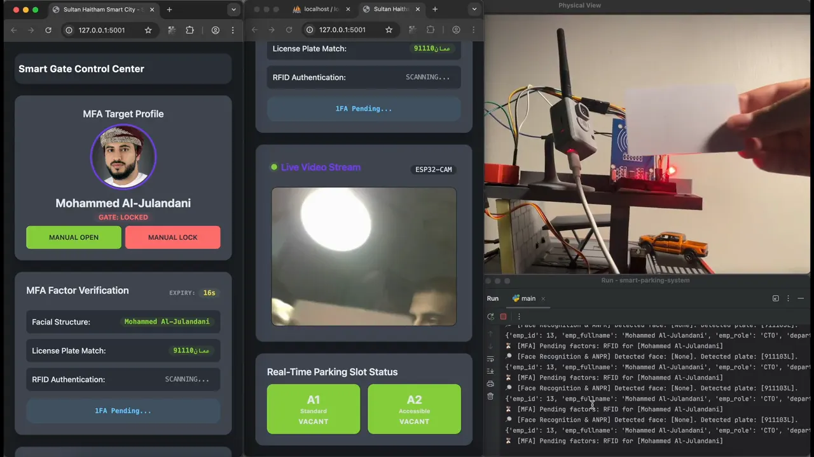
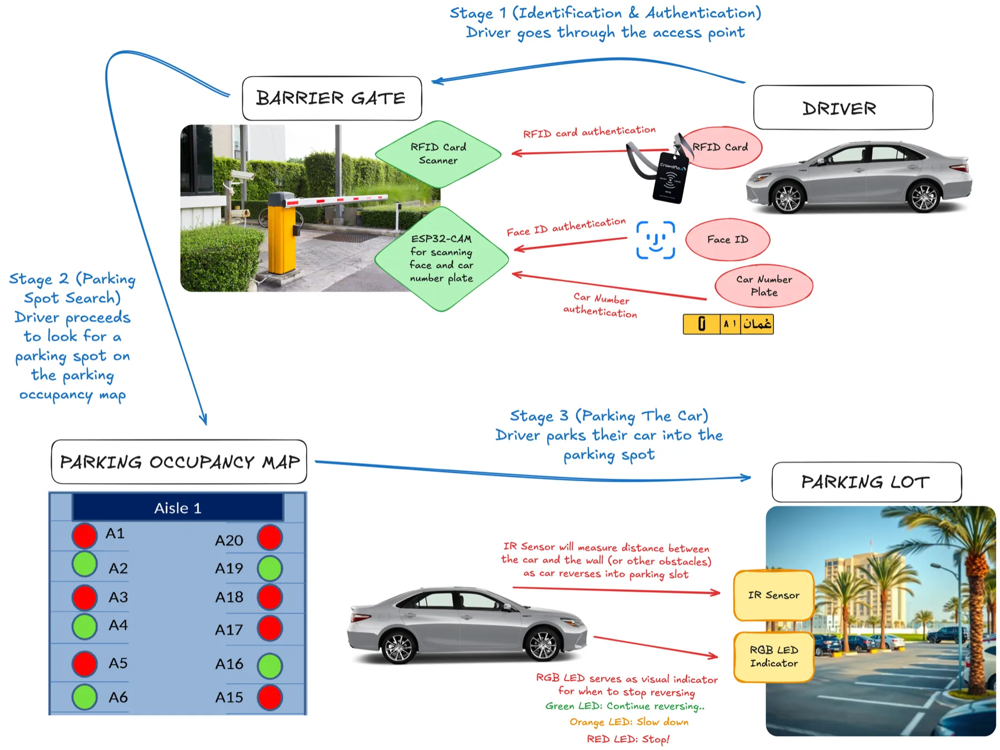
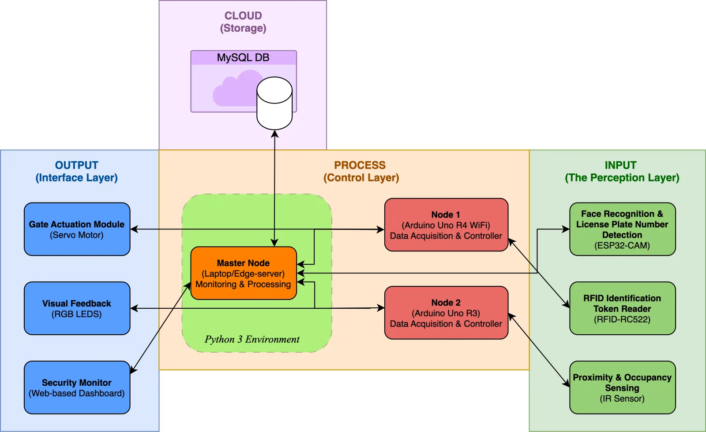
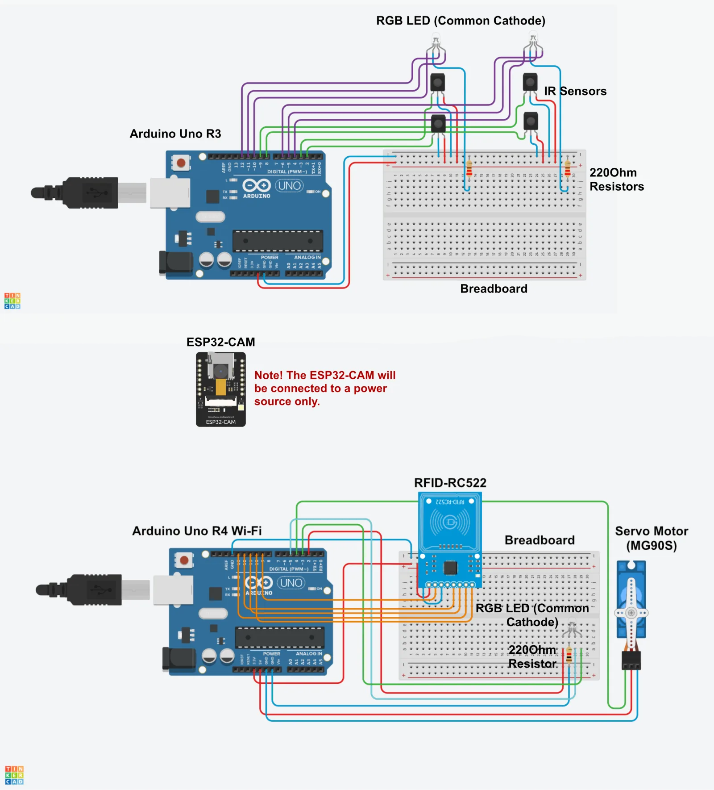

# Smart parking system

A working model of a car park, built as my diploma course project at UTAS Muscat. The barrier gate opens only when a driver's **face**, **number plate** and **RFID card** all match the same registered employee. Inside, the bays guide the car in as it reverses.

It won **Diploma Best Project Idea** at the UTAS Muscat Poster Day in April 2026.

I designed, wired and programmed the system myself. This repository is a showcase of it: the demo, the diagrams and how it works. The source code is not published.

[Watch the demo](media/demo.mp4) · [Full write-up](https://aljulandani.me/blog?post=smart-parking-gate) · [Project page](https://aljulandani.me/project-detail?project=smart-parking-system)

## What a driver goes through

1. **At the gate:** a camera sees the driver's face and number plate, and the driver taps an RFID card. The gate opens only when all three belong to the same active employee, within 30 seconds.
2. **Finding a bay:** a dashboard shows which bays are free.
3. **Parking:** as the car reverses in, an IR sensor watches the gap behind it and an RGB LED says what to do: green to keep reversing, orange to slow down, red to stop.

## How it is built

| Layer | Parts |
| --- | --- |
| Input | ESP32-CAM (face and plate), RFID-RC522 reader, IR sensors in the bays |
| Process | Node 1, an Arduino Uno R4 WiFi (RFID and gate); Node 2, an Arduino Uno R3 (bays); a laptop as the edge server, running Python |
| Output | MG90S servo for the barrier, RGB LEDs, a web dashboard |
| Storage | MySQL: registered employees, access logs, bay occupancy |

The edge server recognises faces with OpenCV, finds number plates with a trained detector and reads them with OCR in Arabic and English. It talks to both Arduinos over serial: it sends the gate one-letter commands to open, close or signal a denied entry, and the Arduinos report RFID taps and bay changes back. The gate closes itself 8 seconds after opening, and every decision is logged.

The dashboard, the *Smart Gate Control Center*, shows the driver being checked, the state of each factor, the live camera, the status of every bay, and buttons for security to open or lock the gate by hand.

## Rights

Copyright (c) 2026 Mohammed Al-Julandani. All rights reserved. See [LICENSE](LICENSE).
